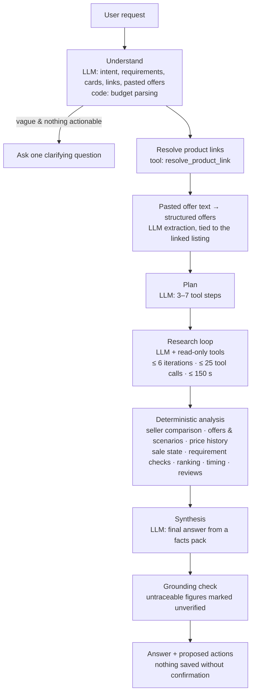

# Architecture

## Principles

- **The LLM reasons; code computes.** The model decides what to research and explains the result. Prices, offer combinations, effective-price scenarios, price statistics and ranking are deterministic code with unit tests.
- **Evidence, not memory.** Every external fact is stored with its source, time and verification level. The final answer is checked so that every price traces back to collected data.
- **Bounded autonomy.** One agent, fixed stages, one research loop capped by iterations, tool calls and time. The model sees only read-only tools; saving anything needs the user's confirmation.
- **Swappable providers.** Data sources and LLMs sit behind small interfaces and registries. Switching is configuration, not code.
- **Simple before clever.** No multi-agent setup, no task queue, no frameworks beyond FastAPI, SQLAlchemy and Pydantic.

## Layers

```
src/shopping_agent/
  config.py, logging.py, errors.py   settings, JSON logs with secret redaction, error types
  domain/       Pydantic types: products, variants, listings, offers, prices, sales, reviews, evidence
  services/     deterministic logic (no I/O): offer engine, price baseline, variant gate, parsers, …
  security/     URL guard (SSRF), untrusted-content handling
  providers/    data sources behind interfaces: product, web search, page fetch, cache, quotas
  db/           SQLAlchemy models, Alembic migrations, repositories
  tools/        the 11 read-only tools the agent can call, and the tool registry
  llm/          LLM adapters, routing/fallback, rate limiting, structured output
  prompts/      versioned prompt files, one per responsibility
  agent/        orchestrator, LLM-backed analyzers, deterministic analysis, grounding, run store
  runtime.py    one shared runtime (DB, cache, providers, tools, LLM) for every interface
  api/          REST API under /v1, with SSE streaming of agent progress
  web/          server-rendered UI (Jinja2 + one script) and the SVG price chart
  cli/          `shop` commands (Typer + Rich)
  demo.py       demo seeding: fictional catalog, synthetic history, fictional sale
  tracking/     watchlist checks, alerts, sale announcements, notifications, confirmed actions, worker
  evals/        evaluation dataset loading, metrics, runner and reports
```

Dependencies point downward: `agent` → `tools` → `providers`/`db` → `services` → `domain`. Services never do I/O, so they are trivially testable.

## The agent pipeline



Code: `src/shopping_agent/agent/orchestrator.py`.

### Stages

1. **Understand** (`agent/analyzers.py`). The LLM produces a `RequestAnalysis`: intent, category, budget, use cases, hard constraints / strong preferences / nice-to-haves, unknowns, product mentions, target price, cards, memberships, EMI preference and any pasted offer text. Deterministic code then:
   - parses the budget from the user's own words (links, quoted passages and pasted offer terms removed). The model decides *whether* a budget exists; code supplies the exact figures. A "budget" equal to the alert target ("alert me below 60k") is dropped: a target for a product is not a spending limit for a search.
   - merges the cards mentioned into a session-only profile (bank + credit/debit only).
   - asks one clarifying question only if the model flags it and there is nothing actionable (no category, product, link or offer).
   - For a follow-up, the earlier answer's products are loaded into the run first (`carry_listing_ids`), so a question that names no product still has subjects. A follow-up about them is never treated as too vague to act on.
2. **Links and pasted offers.** Product links are resolved first, and each outcome (resolved, needs the full link, not found) goes into the facts pack. The answer then says so when a link couldn't be read, for example by asking for the full link instead of a short one. Pasted offer terms are extracted into structured offers (`user_provided`) and stored against the linked listing. Without exactly one linked listing they are not applied, so a coupon for one product can't leak into another product's prices.
3. **Plan.** A short plan of tool steps (unknown tools are dropped). It guides the research prompt.
4. **Research loop.** For follow-ups, the model also sees the earlier conversation and the carried products. The model calls read-only tools, possibly several at once. Calls run concurrently but are recorded in the order the model issued them. Tool results are pruned and truncated before going back to the model. The loop ends when the model stops calling tools or a budget is hit; hitting a budget adds an uncertainty note to the answer.
5. **Deterministic analysis** (`agent/facts.py`). Core features never depend on the model remembering to ask for them. For the leading candidates, code always adds:
   - a seller comparison through the variant gate (top candidate),
   - offers and effective-price scenarios for the user's cards, for up to 3 sellers of each of the top 3 variants. The seller where the user pays least then represents the product (see [deal-engine.md](deal-engine.md#which-seller-represents-a-product)),
   - observed price history and pre-sale hike detection (top 3, after that choice),
   - the current sale state,
   - review evidence and LLM theme analysis (top candidate, for discovery/compare/link/deal/alternatives requests).
   
   Candidates are then ranked by a stated rule: hard-constraint failures, then hard-constraint unknowns, then strong-preference failures, then whether the item was examined in detail during research, then effective price. Timing analysis (buy now / set alert / wait for a sale) is computed from evidence, never predicted.
6. **Synthesis.** The model writes a `FinalAnswer` (summary, recommendations with listing ids and evidence ids, deal insights, timing, risks, uncertainties, questions, suggested actions) using only a compact **facts pack**: ranked candidates with requirement checks, scenarios with conditions, card-wise prices, price history, seller comparison, rejected variants, spec conflicts, review themes, sale events and evidence. If the model fails twice, a deterministic fallback answer is built from the computed results.
7. **Grounding check.** Every money amount and percentage in the answer is compared with prices, offer values, scenario results, history statistics and numbers present in titles and specs. Untraceable figures are marked `[unverified]` and an uncertainty note is added. Recommendations with unknown listing ids are dropped, and unknown evidence ids are removed.
8. **Proposed actions.** Suggested tracking, alerts or preference changes become `ProposedAction`s with status `pending`. Executing them is a separate, user-confirmed step (M6).

### Agent state

`AgentState` (`agent/state.py`) is explicit and structured. It holds the request analysis, requirements, session profile, plan, every tool call record, collected candidates, listings, details, seller comparisons, offers, price histories, reviews, sale events, evidence, conflicts, the ranked focus items, the final answer, the grounding report, proposed actions, uncertainties, warnings and LLM usage. No hidden reasoning is stored. The whole state is saved to `agent_runs` (JSONB) with tool calls in `tool_calls`.

### Failure handling

| Failure | Behaviour |
|---|---|
| A data provider fails or times out | Other providers continue. The tool returns partial results with the error listed. |
| A provider's daily quota is spent | That provider is skipped; cached results are still served |
| Redis unavailable | Caching and rate limiting are skipped; calls continue |
| A tool crashes | The registry contains it and returns a generic error, without internals, to the model |
| Invalid tool arguments | Returned to the model as a validation message so it can correct itself |
| Invalid structured LLM output | One repair attempt with the validation errors, then a clear failure |
| Planning fails | Research continues without a plan |
| LLM route overloaded (e.g. 503) | Next route in `LLM_FALLBACKS` |
| All LLM routes fail | Run ends `failed` with a clear message; state is still saved |
| Synthesis fails | Deterministic fallback answer from the computed results |
| Model refuses | Run ends `failed` with the refusal noted |

## Tools

All tools share one contract (`tools/base.py`): typed input and output models, a timeout, a `side_effect` flag, and a `ToolResult` with `data`, `evidence`, `errors` and `partial`. The registry (`tools/registry.py`) validates arguments, enforces timeouts, denies side-effect tools unless explicitly allowed, contains errors and logs every call.

| Tool | Purpose |
|---|---|
| `resolve_product_link` | Identify the product behind a pasted Amazon/Flipkart/retailer/manufacturer link (tracking parameters removed); fall back to title-based candidates the user must confirm |
| `search_products` | Search across marketplaces; returns candidates grouped by variant, with per-seller listings and risk flags |
| `get_product_details` | Specifications with sources; compares a listing's claims with the specs and reports conflicts |
| `get_listings` | Same product across sellers, passed through the variant gate; mismatches are rejected with reasons |
| `find_offers` | Offers checked against the user's cards, the stacking matrix, scenarios A–D and the card-wise price matrix |
| `research_reviews` | Marketplace ratings plus independent reviews and complaint reports; optional LLM theme analysis |
| `get_price_history` | Observed history, baseline statistics with coverage tier, daily series and pre-sale hike detection |
| `get_sale_events` | Recorded sale events, phases, partner banks, verification status and the current sale state |
| `find_alternatives` | Cheaper or similar products with a transparent attribute comparison |
| `search_web` | Web search focused by purpose (specs, reviews, offers, sale events, news) |
| `fetch_page` | Read an allowlisted page; content is untrusted text |

Write tools (`track_product`, `create_price_alert`, `save_user_preference`) arrive with the watchlist in M6. The confirmation gate that protects them already exists.

## Data providers

`providers/registry.py` holds ordered lists of providers per capability:

- **Platform selection:** a request can limit listings to chosen marketplaces (`platforms`). The orchestrator puts the set in the tool context; `search_products`, `get_listings` and `find_alternatives` ask providers only for those platforms and drop anything else before it is stored. Pasted product links are never filtered.
- **Product providers** (`search`, `lookup`, `get_details`, `get_listings`): `serpapi` (Google Shopping India, Google immersive product pages for per-store prices and features, Amazon product lookup by ASIN) and `fixture` (demo catalog). Search and listings merge results from all providers; lookup and details use the first that answers.
- **Web search providers**: `tavily` and `fixture`.
- **Page fetcher**: `SafeFetcher` (allowlist plus public-IP checks on every redirect hop) or the demo page fetcher.

Every provider call goes through a cache with freshness-based expiry and a per-provider daily quota (`providers/quota.py`, counted per Indian calendar day in Redis).

| Data | Cache time (normal) | During an active sale |
|---|---|---|
| Price / stock | 30 min | 10 min |
| Offers | 1 h | 30 min |
| Sale events | 12 h | 1 h |
| Search results | 6 h | 1 h |
| Reviews | 3 days | 3 days |
| Specifications | 7 days | 7 days |
| Fetched pages | 1 day | 6 h |

Values older than their window are labelled `stale` wherever they are shown.

Product data is stored as it arrives. Each listing gets a price observation, so **price history builds up automatically** from normal use. Listings link to a product (brand + model number) and, when RAM and storage are known for laptops/phones/tablets, to a variant.

## LLM layer

- `llm/openai_compat.py`: Gemini, Groq, OpenRouter, OpenAI and Ollama through their OpenAI-compatible chat endpoints (httpx). Tool calling uses `tool_choice: auto`; structured output uses strict `json_schema`.
- `llm/anthropic_provider.py`: Claude through the official `anthropic` SDK. No forced `tool_choice` and no `temperature` (current models reject both). Structured output uses `output_config.format`, depth is set with `output_config.effort`, and server-side refusal fallback is optional.
- **Replay:** each assistant turn keeps the provider's raw message, which is sent back unchanged to the same provider. This preserves Claude thinking blocks and Gemini thought signatures across tool calls. A different provider rebuilds the turn from neutral fields.
- `llm/client.py`: routes each role (extraction, research, synthesis, analysis) to an ordered list of `provider:model` routes, falls back on failure, paces requests per route, and records calls, tokens and (for priced models) cost per run.
- `llm/structured.py`: converts Pydantic models to strict schemas (`llm/schema.py`), validates the output and makes one repair attempt.
- Prompts (`prompts/`): `agent/system`, `agent/planning`, `agent/research`, `agent/synthesis`, `requirements/extraction`, `reviews/analysis`, `deals/offer_extraction`. Each has a version header, and versions are recorded on every run.

## Data model

| Table | Purpose |
|---|---|
| `users` | Users (single local user for now) |
| `products` | Brand + model number (normalized) |
| `variants` | Product variant by identity key (RAM, storage, connectivity, region) |
| `listings` | A seller's listing on a marketplace: latest price, availability, condition, attributes, raw offer text, provenance |
| `price_observations` | Timestamped prices per listing: the basis of price history |
| `offers` | Structured offers with full terms, scope (platform, listing or variant), verification and validity |
| `evidence` | Sourced claims with verification and confidence |
| `sale_events` | Sale events with phases, partner banks and verification |
| `agent_runs` | Every run: status, intent, request, summary and full state |
| `tool_calls` | Every tool call of every run: arguments, status, latency, errors, cache use |
| `payment_methods`, `memberships`, `exchange_devices`, `user_preferences` | The user's profile: bank and card type only, memberships, devices to exchange, preferences |
| `watch_items` | Tracked listings with targets, the last check and the next check time |
| `effective_price_snapshots` | Price for the user's cards at each check |
| `alert_events` | Each alert once (unique `dedup_key`) |
| `notifications` | Delivery per alert and channel (in-app, email, Telegram) |

Migrations live in `src/shopping_agent/db/migrations/versions/`, numbered `0001` to `0005` (`0004` profile, `0005` tracking).

## Observability

- JSON logs with a `tool_call` line per tool execution (run id, tool, status, latency, cache, evidence count) and an `agent_run` summary per run (tool calls, LLM calls, tokens, evidence, duration).
- Secrets are redacted from every log line: API keys in headers or URLs, tokens, passwords and card-number-like digit runs. httpx request logging is turned down because some providers put keys in URLs.
- `agent_runs` and `tool_calls` make every run traceable and replayable for debugging and evaluation.
- The agent emits progress events (stage, tool call, tool result, warning, done) that the interfaces stream to the user.

## Design decisions and deviations from the original specification

| Decision | Reason |
|---|---|
| 11 read-only tools (not 20); deals, coupons and bank offers merged into `find_offers`; price + seller merged into `get_listings` | Fewer, clearer tools are chosen more reliably, especially by free models |
| Effective price, stacking, comparison, budget and timing are services, not LLM tools | The LLM never does arithmetic |
| Custom orchestrator, no agent framework | Full control over budgets, trust boundaries and grounding; easy to test |
| Two LLM adapters (OpenAI-compatible + Anthropic SDK) | Covers all providers with little code |
| Ranking is a stated rule with requirement checks, not a weighted score | Transparent; no arbitrary scores |
| Deterministic enrichment after research | Offers, history, seller comparison and reviews don't depend on the model remembering to ask |
| Postgres + Redis (both already installed) | Concurrent API and worker processes, JSONB, real TTLs |
| Worker is a plain asyncio loop with a per-tick Redis counter, not APScheduler | One periodic job doesn't need a scheduler library; two workers can't do the same tick |
| Three write tools exist but are never shown to the model; they run only on confirmation | Keeps "the user decides" structural, not a prompt instruction |
| A monitoring refresh deactivates offers a provider no longer shows for that listing | Offers are stored by their terms, so without this an ended or changed offer would keep counting |
| Ingest writes rows in a fixed order (product, then listing), and a tool call that still hits a database deadlock is retried once | The model often runs several searches at once, and their writes overlap on the same products. The evaluation caught a deadlock; `test_parallel_overlapping_searches_do_not_deadlock` reproduces it without the fix. |
| Standard-library HTML-to-text instead of selectolax | One less dependency |
| Sale phases stored inside the sale-event row (JSONB) | Always read together |
| Raw offer text from product pages is shown but never priced | Terse marketplace offer text lacks caps and conditions; only structured or user-pasted offers enter calculations |
